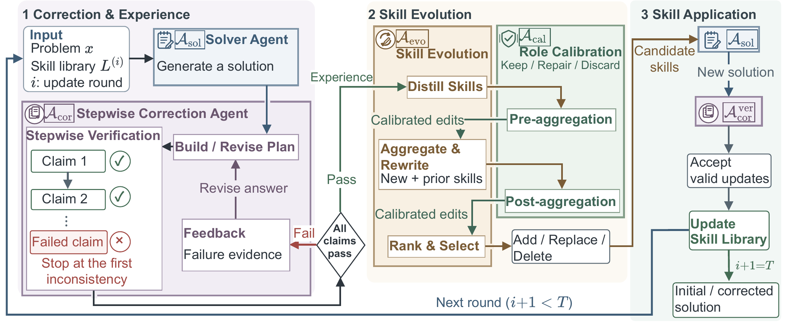

# SC2SE：从自纠错到自进化

**From Self-Correction to Self-Evolution: Agentic Test-Time Learning for Mathematical Reasoning**

SC2SE 把数学解题中的纠错经验整理成可复用的技能，供模型下一轮作答时使用。模型在测试时更新技能库，模型参数保持冻结，标准答案仅用于评分。

## 方法框架

[](assets/framework.png)

求解智能体先作答，逐步纠错智能体检查解题过程，并根据发现的问题修正回答。技能进化智能体从这些记录中提炼解题方法，与已有技能合并。角色校准智能体在合并前后检查每条技能，确保它给出的是解题时可执行的建议。求解智能体带着更新后的技能重新作答，新一轮的验证和纠错又为技能更新提供经验。

## 主要结果

[](assets/main-results.png)

表中 Base 是各方法共用的初答。SC2SE 从空技能库开始，在同一批题目上更新四轮；最后固定技能库，分别评价使用技能重新生成的初答（SC2SE<sub>init</sub>）和进一步纠错后的回答（SC2SE<sub>corr</sub>）。

## 安装与环境配置

在仓库根目录执行：

```bash
python -m pip install -r requirements.txt
```

示例调用 DeepSeek 官方 API。请设置 `DEEPSEEK_API_KEY`。PowerShell 使用 `$env:DEEPSEEK_API_KEY = "<your-key>"`，Bash 使用 `export DEEPSEEK_API_KEY="<your-key>"`。

## 快速开始

仓库附带的 `demo` 包含两道数学题。执行下面两步会调用模型。

### 1. 生成公共初答

```bash
python 0-1_initial_response/generate_initial_responses.py --dataset demo --output-dir runs/initial
```

初答保存在本地 `runs/initial/deepseek-flash_demo_first_response.jsonl`，评分保存在同目录的 `demo.initial-eval.json`。比较不同方法时可共用这批初答，在第 2 步用 `--initial-dir` 指向保存初答和版本记录的目录。

### 2. 运行 SC2SE 并评分

```bash
python 0-3_all_model_test/run_plan_S_SC/S_SC_S5-8-0_initialSolverSkill+strictACC+skillOptP1-1+compress/run_sc2se.py --dataset demo --initial-dir runs/initial --run
```

程序从公共初答开始验证与纠错，完成四轮技能更新后，用固定的技能库重新作答。结果默认写入 `runs/<UTC时间戳>/`。其中 `demo/final_skill_evaluation/results.jsonl` 保存使用技能的初答和纠错后的回答。两类回答均用同一评分程序评价，结果分别保存在 `evaluation_initial.json` 和 `evaluation_corrected.json`。Python 工具会在本机执行模型生成的代码，请使用专用、低权限的环境。

要改跑 HMMT，请先按 `0-0_datasets/README.md` 准备题集，再将两步命令中的 `--dataset demo` 换成 `--dataset hmmt_feb_2025`。

部分验证与纠错代码改编自 ProgCo，技能更新代码参考了 SkillOpt，详见[来源说明](THIRD_PARTY.md)。

## 引用

arXiv 链接待补。

```bibtex
@misc{zou2026sc2se,
  title = {From Self-Correction to Self-Evolution: Agentic Test-Time Learning for Mathematical Reasoning},
  author = {Zou, Rui and Zhu, Yutao and Wei, Mengqi and Wen, Ji-Rong},
  year = {2026}
}
```
