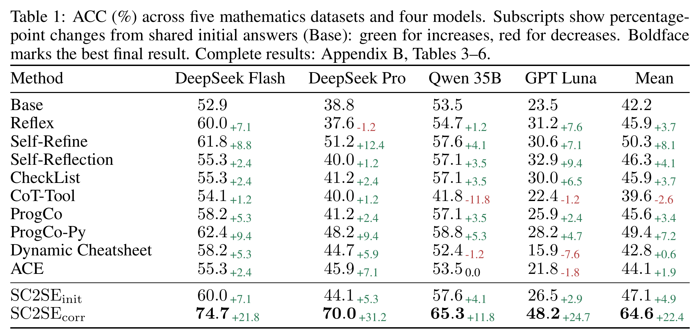

# From Self-Correction to Self-Evolution: Agentic Test-Time Learning for Mathematical Reasoning

English | [简体中文](README_zh-CN.md)

SC2SE turns correction experience from mathematical problem solving into reusable skills for the model's next round of answering. The skill library is updated at test time while model parameters remain frozen. Reference answers are used only for evaluation.

## Framework

[](assets/framework.png)

The solver agent first generates a response. The stepwise correction agent checks the solution process and revises the response based on the issues it finds. The skill evolution agent distills problem-solving methods from these records and merges them with existing skills. The role calibration agent checks each skill before and after merging to ensure it provides actionable advice for solving problems. The solver agent answers again using the updated skills, and the next round of verification and correction provides further experience for skill updating.

## Main Results

[](assets/main-results.png)

In the table, Base denotes the initial responses shared by the methods. SC2SE starts with an empty skill library and updates it over four rounds on the same batch of problems. The final skill library is then fixed, and initial responses newly generated with skills (SC2SE<sub>init</sub>) and responses after further correction (SC2SE<sub>corr</sub>) are evaluated separately.

## Installation and Configuration

Run the following command from the repository root:

```bash
python -m pip install -r requirements.txt
```

The example uses the official DeepSeek API. Set `DEEPSEEK_API_KEY`. In PowerShell, use `$env:DEEPSEEK_API_KEY = "<your-key>"`; in Bash, use `export DEEPSEEK_API_KEY="<your-key>"`.

## Quick Start

The included `demo` contains two mathematics problems. The following two steps call the model API.

### 1. Generate Shared Initial Responses

```bash
python 0-1_initial_response/generate_initial_responses.py --dataset demo --output-dir runs/initial
```

Initial responses are saved locally to `runs/initial/deepseek-flash_demo_first_response.jsonl`, and their scores are saved to `demo.initial-eval.json` in the same directory. When comparing methods, you can share this batch of initial responses. In step 2, set `--initial-dir` to the directory containing the initial responses and model version records.

### 2. Run SC2SE and Evaluate

```bash
python 0-3_all_model_test/run_plan_S_SC/S_SC_S5-8-0_initialSolverSkill+strictACC+skillOptP1-1+compress/run_sc2se.py --dataset demo --initial-dir runs/initial --run
```

The program begins verification and correction from the shared initial responses. After four rounds of skill updating, it answers again using the fixed skill library. By default, results are saved to `runs/<UTC-timestamp>/`. The file `demo/final_skill_evaluation/results.jsonl` contains initial responses generated with skills and responses after correction. Both response types use the same evaluator, with results saved to `evaluation_initial.json` and `evaluation_corrected.json`, respectively. The Python tool executes model-generated code on your machine, so use a dedicated environment with restricted permissions.

To run HMMT, first prepare the dataset as described in `0-0_datasets/README.md`, then replace `--dataset demo` with `--dataset hmmt_feb_2025` in both commands.

Parts of the verification and correction code are adapted from ProgCo, and the skill-update code draws on SkillOpt. See [attribution](THIRD_PARTY.md).

## Citation

arXiv link to be added.

```bibtex
@misc{zou2026sc2se,
  title = {From Self-Correction to Self-Evolution: Agentic Test-Time Learning for Mathematical Reasoning},
  author = {Zou, Rui and Zhu, Yutao and Wei, Mengqi and Wen, Ji-Rong},
  year = {2026}
}
```
